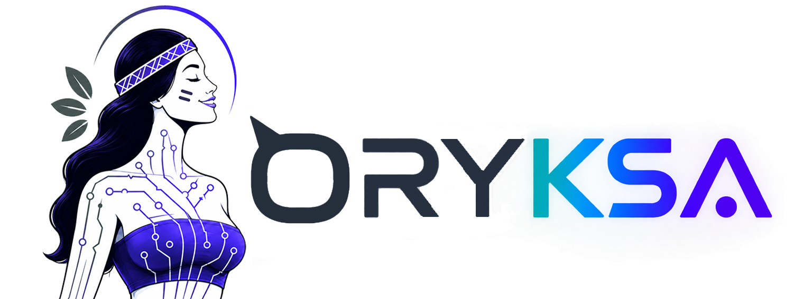
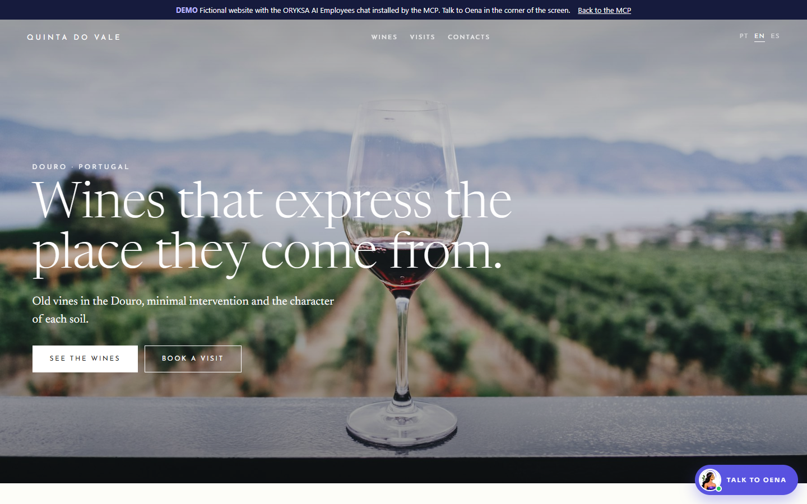
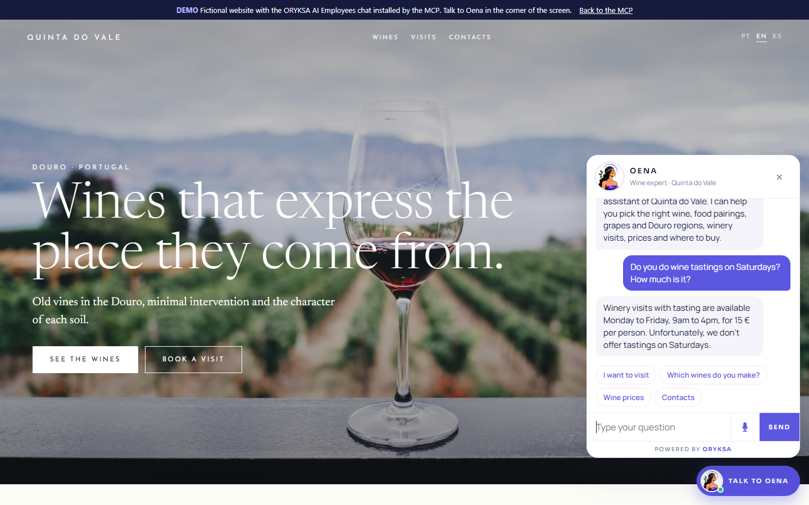
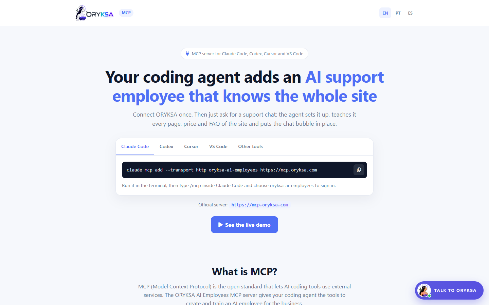

<p align="center"></p>
<p align="center"><a href="https://glama.ai/mcp/connectors/com.oryksa/ai-employees"></a></p>

# ORYKSA AI Employees (servidor MCP)

[](README.md) [](README.pt.md) [](README.es.md) [](README.fr.md)

Añade un empleado de IA de atención al cliente al sitio web que estás construyendo, directamente desde tu herramienta de programación con IA.
Tu agente de programación conecta ORYKSA, **enseña al agente todo el sitio** (páginas, precios, FAQ) e instala un
chat que responde a los visitantes con **texto y voz**. El mismo empleado también atiende a tus clientes en WhatsApp y Telegram.

- **URL del servidor:** `https://mcp.oryksa.com` (remoto, streamable HTTP, inicio de sesión OAuth 2.1 en el navegador)
- **Sitio web:** https://mcp.oryksa.com
- **Demo en vivo:** https://mcp.oryksa.com/demo/en
- **Directorio de conectores de Claude:** [claude.ai/directory/connectors/oryksa](https://claude.ai/directory/connectors/oryksa)
- **Listado en:** [awesome-remote-mcp-servers](https://github.com/punkpeye/awesome-remote-mcp-servers) · [Glama](https://glama.ai/mcp/connectors/com.oryksa/ai-employees)
- **Portal para desarrolladores (API, webhooks, SDKs):** https://developer.oryksa.com · SDK: [oryksa/oryksa-js](https://github.com/oryksa/oryksa-js)
- **Registro MCP oficial:** [`com.oryksa/ai-employees`](https://registry.modelcontextprotocol.io/v0/servers?search=com.oryksa)

## Demo en vivo

Un sitio web ficticio de una bodega con el chat de ORYKSA instalado mediante el MCP. Ábrelo y habla con el agente por texto o voz:
**https://mcp.oryksa.com/demo/en**

[](https://mcp.oryksa.com/demo/en)

El agente responde con lo que aprendió en el sitio (precios, horarios, visitas):

[](https://mcp.oryksa.com/demo/en)

[](https://mcp.oryksa.com)

## Instalar

**Claude Code**
```bash
claude mcp add --transport http oryksa-ai-employees https://mcp.oryksa.com
```
Después escribe `/mcp` en Claude Code, elige `oryksa-ai-employees` e inicia sesión.

**Plugin de Claude Code (servidor MCP + skill)**
```bash
/plugin marketplace add oryksa/oryksa-mcp
/plugin install oryksa-ai-employees@oryksa-ai-employees
```

**Codex** (`~/.codex/config.toml`)
```toml
[mcp_servers.oryksa-ai-employees]
url = "https://mcp.oryksa.com"
```
Después ejecuta `codex mcp login oryksa-ai-employees`.

**Cursor** (`.cursor/mcp.json`) / **VS Code** (`.vscode/mcp.json`)
```json
{ "mcpServers": { "oryksa-ai-employees": { "url": "https://mcp.oryksa.com" } } }
```

## Solo pídelo

> Añade a este sitio un chat de atención al cliente con la IA de ORYKSA y enséñale todo lo que hay en el sitio.

## Herramientas

| Herramienta | Qué hace |
|---|---|
| `oryksa_status` | Cuenta, plan, interacciones restantes, lo que el agente ya sabe |
| `oryksa_setup_business` | Nombre del negocio, servicios, precios, horarios, idiomas, tono |
| `oryksa_learn_site` | Enseña al agente el texto visible de todas las páginas del proyecto |
| `oryksa_learn_from_url` | Lee un sitio en vivo y escribe la ficha de datos del negocio |
| `oryksa_add_faq` | Preguntas y respuestas exactas |
| `oryksa_get_widget_snippet` | Código del chat para HTML, Next.js, React, Vue, Nuxt, Astro, Svelte, Angular, WordPress |
| `oryksa_customize_chat` | Foto del agente, saludo y sugerencias rápidas |
| `oryksa_set_allowed_domains` | Limita el chat a los dominios del sitio |
| `oryksa_test_agent` | Hace al agente preguntas reales de clientes (gratis) |
| `oryksa_links` | Panel, conexión de WhatsApp, planes |

## Bonus para desarrolladores

Las cuentas conectadas mediante el MCP reciben **+100 interacciones por día durante los primeros 30 días**, además del plan Free (50 por semana), chat del sitio web incluido.

## Seguridad y privacidad

El inicio de sesión se hace en tu navegador con OAuth; la herramienta nunca ve tu contraseña. Las herramientas no pueden eliminar la cuenta,
hacer pagos ni conectar WhatsApp. Política de privacidad: https://oryksa.com/en/privacy/#mcp · Contacto: info@oryksa.com

## Sobre el autor

**Weslley Harakawa** - Fundador de ORYKSA AI y Chief Innovation Officer de Harakawa Tech. En Lisboa, Portugal. Especialidades: inteligencia artificial, desarrollo web y móvil, tokenización en blockchain. Formación: University of the People.

- Sitio web: https://harakawa.tech
- LinkedIn: https://www.linkedin.com/in/weslleyharakawa/
- Instagram: https://www.instagram.com/weslley.harakawa
- ORYKSA AI Employees: https://oryksa.com (X: https://x.com/oryksa, Instagram: https://www.instagram.com/oryksaai, YouTube: https://www.youtube.com/@ORYKSA)

© ORYKSA AI Employees · W8 Atlantic Unipessoal Lda
