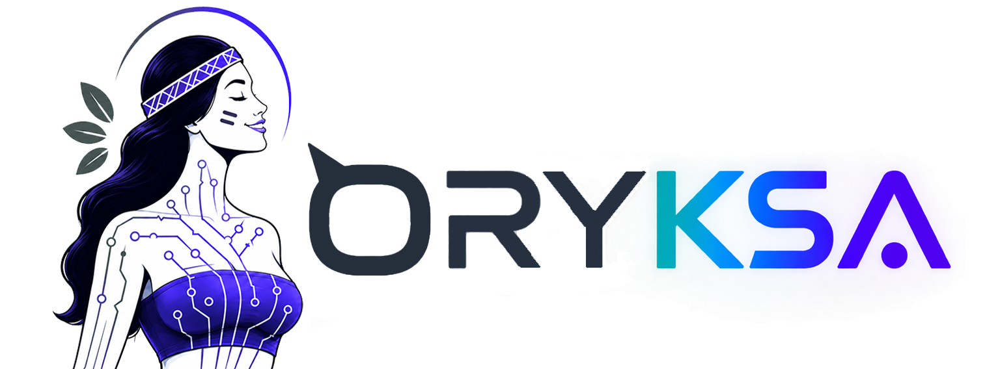
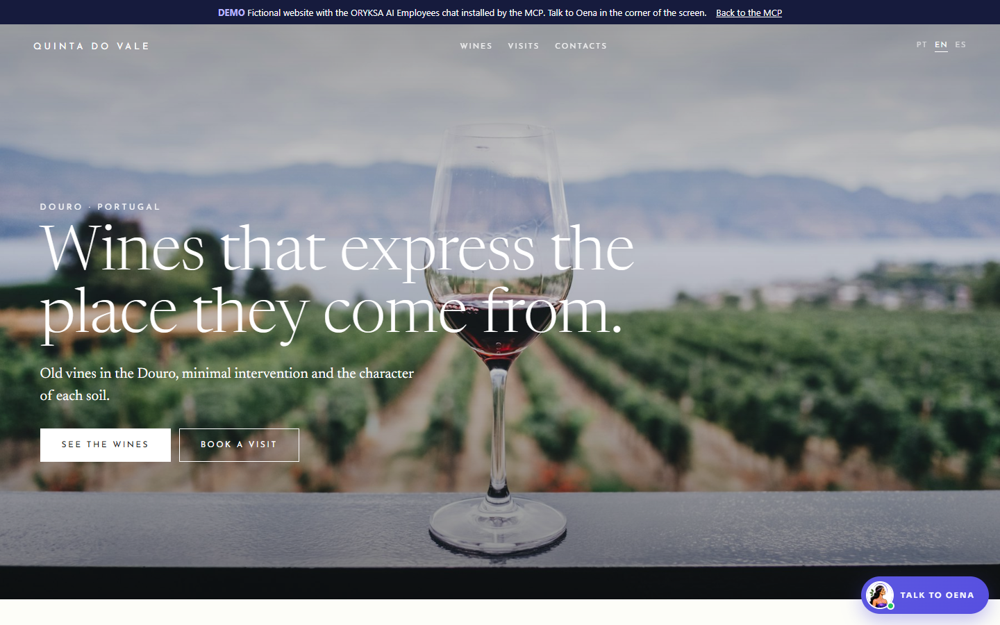
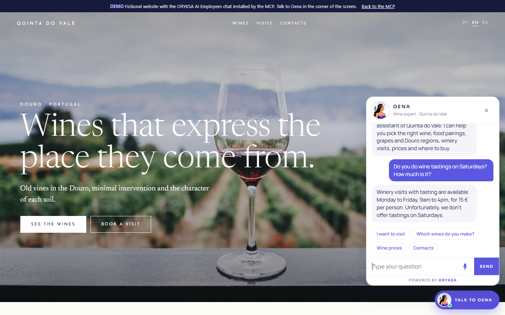
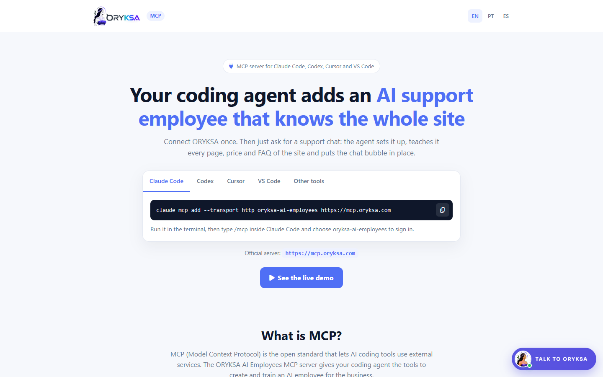

<p align="center"></p>
<p align="center"><a href="https://glama.ai/mcp/connectors/com.oryksa/ai-employees"></a></p>

# ORYKSA AI Employees (serveur MCP)

[](README.md) [](README.pt.md) [](README.es.md) [](README.fr.md)

Ajoutez un employé IA de support client au site web que vous construisez, directement depuis votre outil de programmation IA.
Votre agent de programmation connecte ORYKSA, **apprend à l'agent tout le site** (pages, prix, FAQ) et installe un
chat qui répond aux visiteurs en **texte et en voix**. Le même employé répond aussi à vos clients sur WhatsApp et Telegram.

- **URL du serveur :** `https://mcp.oryksa.com` (distant, streamable HTTP, connexion OAuth 2.1 dans le navigateur)
- **Site web :** https://mcp.oryksa.com
- **Démo en direct :** https://mcp.oryksa.com/demo/en
- **Répertoire des connecteurs Claude :** [claude.ai/directory/connectors/oryksa](https://claude.ai/directory/connectors/oryksa)
- **Référencé dans :** [awesome-remote-mcp-servers](https://github.com/punkpeye/awesome-remote-mcp-servers) · [Glama](https://glama.ai/mcp/connectors/com.oryksa/ai-employees)
- **Portail développeurs (API, webhooks, SDKs) :** https://developer.oryksa.com · SDK : [oryksa/oryksa-js](https://github.com/oryksa/oryksa-js)
- **Registre MCP officiel :** [`com.oryksa/ai-employees`](https://registry.modelcontextprotocol.io/v0/servers?search=com.oryksa)

## Démo en direct

Un site web fictif de cave à vin avec le chat ORYKSA installé via le MCP. Ouvrez-le et parlez à l'agent par texte ou par voix :
**https://mcp.oryksa.com/demo/en**

[](https://mcp.oryksa.com/demo/en)

L'agent répond à partir de ce qu'il a appris sur le site (prix, horaires, visites) :

[](https://mcp.oryksa.com/demo/en)

[](https://mcp.oryksa.com)

## Installer

**Claude Code**
```bash
claude mcp add --transport http oryksa-ai-employees https://mcp.oryksa.com
```
Tapez ensuite `/mcp` dans Claude Code, choisissez `oryksa-ai-employees` et connectez-vous.

**Plugin Claude Code (serveur MCP + skill)**
```bash
/plugin marketplace add oryksa/oryksa-mcp
/plugin install oryksa-ai-employees@oryksa-ai-employees
```

**Codex** (`~/.codex/config.toml`)
```toml
[mcp_servers.oryksa-ai-employees]
url = "https://mcp.oryksa.com"
```
Exécutez ensuite `codex mcp login oryksa-ai-employees`.

**Cursor** (`.cursor/mcp.json`) / **VS Code** (`.vscode/mcp.json`)
```json
{ "mcpServers": { "oryksa-ai-employees": { "url": "https://mcp.oryksa.com" } } }
```

## Demandez simplement

> Add an AI customer support chat to this site with ORYKSA and teach it everything on the site.

## Outils

| Outil | Ce qu'il fait |
|---|---|
| `oryksa_status` | Compte, forfait, interactions restantes, ce que l'agent sait déjà |
| `oryksa_setup_business` | Nom de l'entreprise, services, prix, horaires, langues, ton |
| `oryksa_learn_site` | Apprend à l'agent le texte visible de chaque page du projet |
| `oryksa_learn_from_url` | Lit un site en ligne et écrit la fiche d'informations de l'entreprise |
| `oryksa_add_faq` | Questions et réponses exactes |
| `oryksa_get_widget_snippet` | Code du chat pour HTML, Next.js, React, Vue, Nuxt, Astro, Svelte, Angular, WordPress |
| `oryksa_customize_chat` | Photo de l'agent, message d'accueil et suggestions rapides |
| `oryksa_set_allowed_domains` | Limite le chat aux domaines du site |
| `oryksa_test_agent` | Pose à l'agent de vraies questions de clients (gratuit) |
| `oryksa_links` | Tableau de bord, connexion WhatsApp, forfaits |

## Bonus développeur

Les comptes connectés via le MCP reçoivent **+100 interactions par jour pendant les 30 premiers jours**, en plus du forfait Free (50 par semaine), chat du site web inclus.

## Sécurité et confidentialité

La connexion se fait dans votre navigateur avec OAuth ; l'outil ne voit jamais votre mot de passe. Les outils ne peuvent pas supprimer le compte,
effectuer de paiements ni connecter WhatsApp. Politique de confidentialité : https://oryksa.com/en/privacy/#mcp · Contact : info@oryksa.com

## À propos de l'auteur

**Weslley Harakawa** - Fondateur d'ORYKSA AI et Chief Innovation Officer chez Harakawa Tech. À Lisbonne, Portugal. Spécialités : intelligence artificielle, développement web et mobile, tokenisation blockchain. Formation : University of the People.

- Site web : https://harakawa.tech
- LinkedIn : https://www.linkedin.com/in/weslleyharakawa/
- Instagram : https://www.instagram.com/weslley.harakawa
- ORYKSA AI Employees : https://oryksa.com (X: https://x.com/oryksa, Instagram: https://www.instagram.com/oryksaai, YouTube: https://www.youtube.com/@ORYKSA)

© ORYKSA AI Employees · W8 Atlantic Unipessoal Lda
