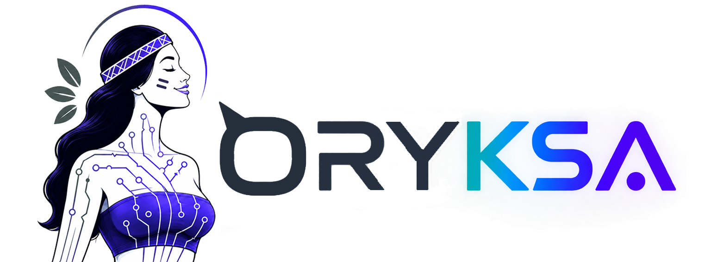
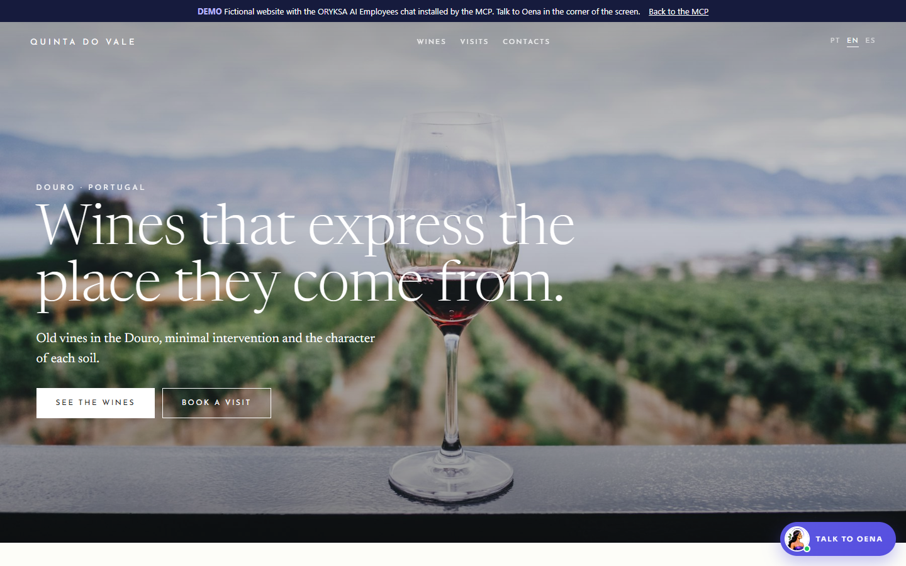
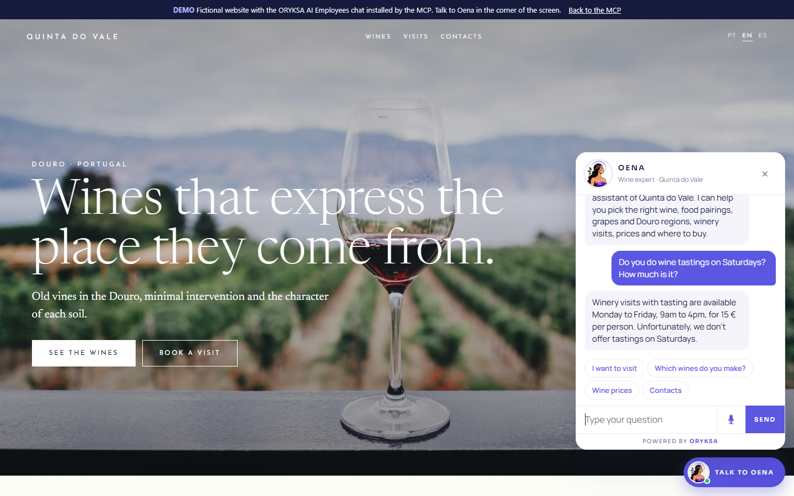
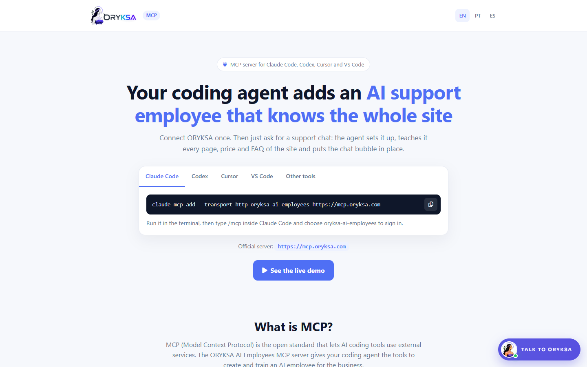

<p align="center"></p>
<p align="center"><a href="https://glama.ai/mcp/connectors/com.oryksa/ai-employees"></a></p>

# ORYKSA AI Employees (servidor MCP)

[](README.md) [](README.pt.md) [](README.es.md) [](README.fr.md)

Adiciona um colaborador de IA de apoio ao cliente ao site que estás a construir, diretamente a partir da tua ferramenta de programação com IA.
O teu agente de programação liga a ORYKSA, **ensina ao agente o site inteiro** (páginas, preços, FAQ) e instala um
chat que responde aos visitantes com **texto e voz**. O mesmo colaborador também atende os teus clientes no WhatsApp e no Telegram.

- **URL do servidor:** `https://mcp.oryksa.com` (remoto, streamable HTTP, início de sessão OAuth 2.1 no navegador)
- **Site:** https://mcp.oryksa.com
- **Demonstração ao vivo:** https://mcp.oryksa.com/demo/en
- **Diretório de conectores do Claude:** [claude.ai/directory/connectors/oryksa](https://claude.ai/directory/connectors/oryksa)
- **Listado em:** [awesome-remote-mcp-servers](https://github.com/punkpeye/awesome-remote-mcp-servers) · [Glama](https://glama.ai/mcp/connectors/com.oryksa/ai-employees)
- **Portal de programadores (API, webhooks, SDKs):** https://developer.oryksa.com · SDK: [oryksa/oryksa-js](https://github.com/oryksa/oryksa-js)
- **Registo MCP oficial:** [`com.oryksa/ai-employees`](https://registry.modelcontextprotocol.io/v0/servers?search=com.oryksa)

## Demonstração ao vivo

Um site fictício de uma adega com o chat da ORYKSA instalado através do MCP. Abre-o e fala com o agente por texto ou voz:
**https://mcp.oryksa.com/demo/en**

[](https://mcp.oryksa.com/demo/en)

O agente responde com o que aprendeu no site (preços, horários, visitas):

[](https://mcp.oryksa.com/demo/en)

[](https://mcp.oryksa.com)

## Instalar

**Claude Code**
```bash
claude mcp add --transport http oryksa-ai-employees https://mcp.oryksa.com
```
Depois escreve `/mcp` no Claude Code, escolhe `oryksa-ai-employees` e inicia sessão.

**Plugin do Claude Code (servidor MCP + skill)**
```bash
/plugin marketplace add oryksa/oryksa-mcp
/plugin install oryksa-ai-employees@oryksa-ai-employees
```

**Codex** (`~/.codex/config.toml`)
```toml
[mcp_servers.oryksa-ai-employees]
url = "https://mcp.oryksa.com"
```
Depois executa `codex mcp login oryksa-ai-employees`.

**Cursor** (`.cursor/mcp.json`) / **VS Code** (`.vscode/mcp.json`)
```json
{ "mcpServers": { "oryksa-ai-employees": { "url": "https://mcp.oryksa.com" } } }
```

## Basta pedir

> Add an AI customer support chat to this site with ORYKSA and teach it everything on the site.

## Ferramentas

| Ferramenta | O que faz |
|---|---|
| `oryksa_status` | Conta, plano, interações restantes, o que o agente já sabe |
| `oryksa_setup_business` | Nome do negócio, serviços, preços, horários, idiomas, tom |
| `oryksa_learn_site` | Ensina ao agente o texto visível de todas as páginas do projeto |
| `oryksa_learn_from_url` | Lê um site em direto e escreve a ficha de factos do negócio |
| `oryksa_add_faq` | Perguntas e respostas exatas |
| `oryksa_get_widget_snippet` | Código do chat para HTML, Next.js, React, Vue, Nuxt, Astro, Svelte, Angular, WordPress |
| `oryksa_customize_chat` | Foto do agente, saudação e sugestões rápidas |
| `oryksa_set_allowed_domains` | Limita o chat aos domínios do site |
| `oryksa_test_agent` | Faz ao agente perguntas reais de clientes (grátis) |
| `oryksa_links` | Painel, ligação ao WhatsApp, planos |

## Bónus para programadores

As contas ligadas através do MCP recebem **+100 interações por dia durante os primeiros 30 dias**, além do plano Free (50 por semana), incluindo o chat do site.

## Segurança e privacidade

O início de sessão é feito no teu navegador com OAuth; a ferramenta nunca vê a tua palavra-passe. As ferramentas não conseguem apagar a conta,
fazer pagamentos nem ligar o WhatsApp. Política de privacidade: https://oryksa.com/en/privacy/#mcp · Contacto: info@oryksa.com

## Sobre o autor

**Weslley Harakawa** - Fundador da ORYKSA AI e Chief Innovation Officer da Harakawa Tech. Em Lisboa, Portugal. Especialidades: inteligência artificial, desenvolvimento web e mobile, tokenização em blockchain. Formação: University of the People.

- Website: https://harakawa.tech
- LinkedIn: https://www.linkedin.com/in/weslleyharakawa/
- Instagram: https://www.instagram.com/weslley.harakawa
- ORYKSA AI Employees: https://oryksa.com (X: https://x.com/oryksa, Instagram: https://www.instagram.com/oryksaai, YouTube: https://www.youtube.com/@ORYKSA)

© ORYKSA AI Employees · W8 Atlantic Unipessoal Lda
